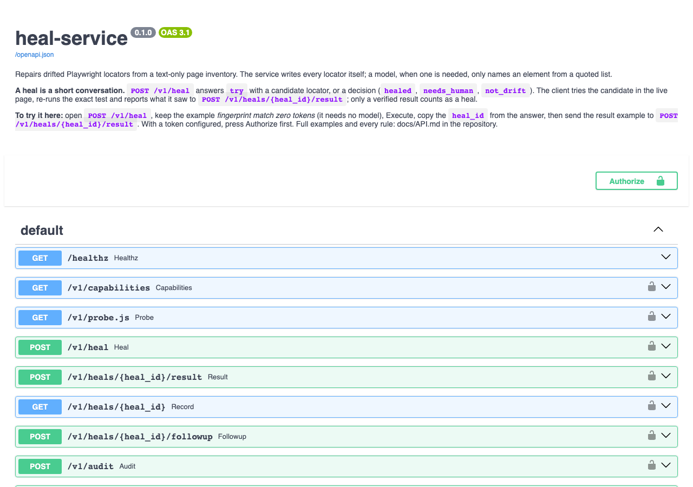
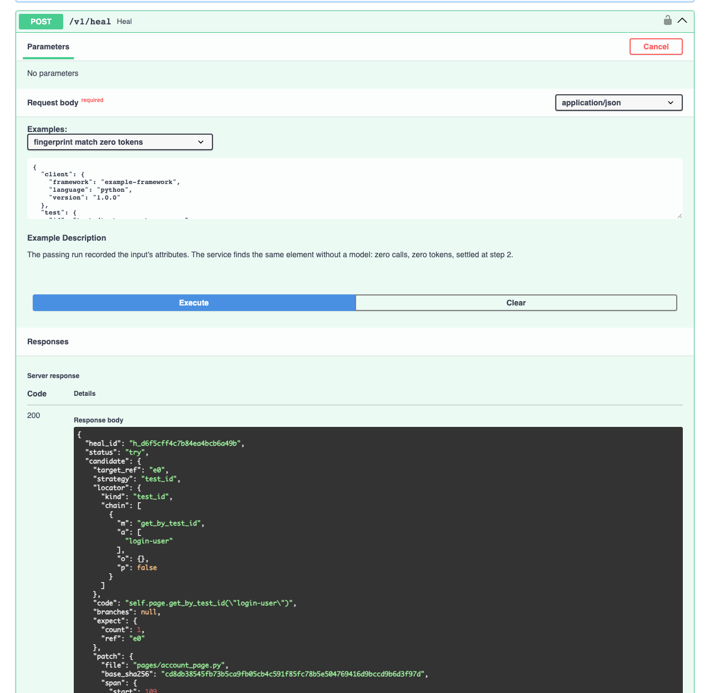
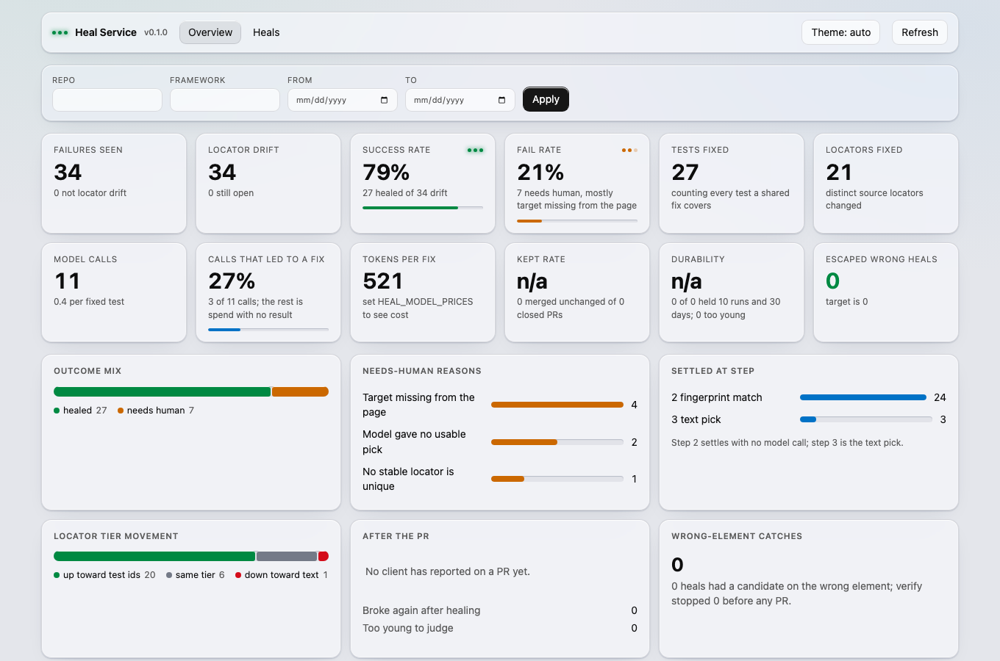
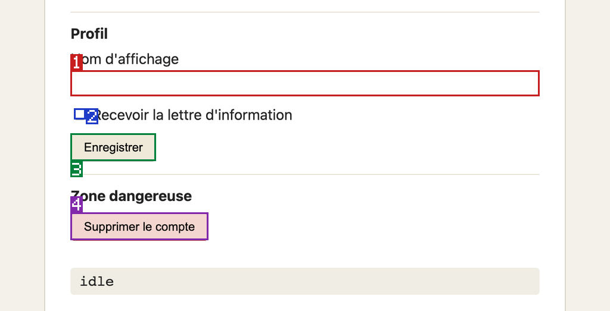
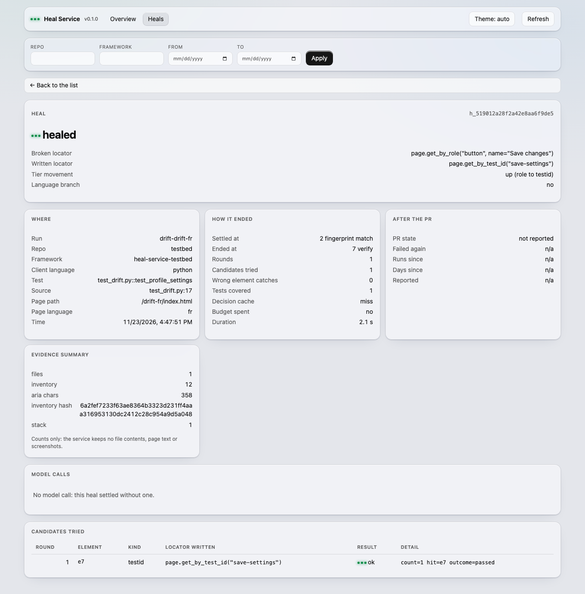
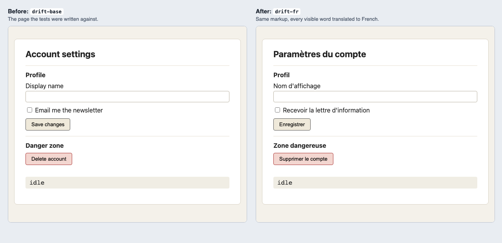

<p align="center">
  <picture>
    <source media="(prefers-color-scheme: dark)" srcset="docs/images/logo-on-dark.png">
    
  </picture>
</p>

# voyageur

A small HTTP service that repairs drifted Playwright locators. A test framework sends it a failure (the error, the source files
from the stack, a text-only inventory of the page); the service finds the element the broken step meant, writes a better
locator for it **itself**, and answers with a patch to try. The client applies the patch, re-runs the exact test and reports what
it saw. Only a verified result counts as a heal.

- **Text first, no browser.** By default the service sees attributes and visible copy only: never a DOM, a cookie or anything a person
  typed, and it fetches no page. A screenshot is accepted only when the operator turns vision on (see [Vision](#vision-optional)).
- **The model picks, the service writes.** When a model is needed (one call, a short list of quoted candidates), it can only name a listed
  element. Locator text is always produced by the service, ranked by stability (test id, id, name, css on a stable attribute, role
  and name, label, text) and checked for uniqueness against the inventory; a heading, label or paragraph gets a stable attribute when it has one,
  else role and name (`get_by_role("heading", name=..., level=2)`), else exact text, and a copy locator is written only when the request proves
  it unique (with a reason when it cannot). Nothing a model says becomes code.
- **Cheapest step first.** Triage and a same-element match against the last passing run need no model at all.
- **Every heal is recorded** (decision, step, tokens, candidates tried) and aggregated at `/v1/metrics`; every number drills down to the
  heals behind it, and `/dashboard` shows them with no external service.
- **Other ways in.** Advise mode (`options.mode: "advise"`) answers with the best locator and no patch; `POST /v1/audit` ranks the
  locators already in your files; `voyageur mcp` offers both to an MCP client.

## Why "Voyageur"

The voyageurs were the French-Canadian canoe men who guided the fur-trade expeditions across North America. They read the river
ahead, picked the route through the rapids, carried the load across every portage and patched the canoe when a rock opened it, so
the expedition kept moving. That is the job here: a test agent is the traveller, and voyageur knows the water. (The English spelling,
"voyager", already belongs to other people.)

Today it does the patching: when a locator drifts, it finds the element the step meant, writes a better locator and proves it in the
live page. Two more parts are planned:

- **Guiding.** Coach a Playwright agent while it builds a test: the next step through a flow, stable locators the service writes and
  proves unique, and the verification step worth adding after each action, drawn from the tests a repository already has.
- **Flow healing.** Repair a test whose flow changed shape (a new step, a reordered page, an added dialog), not only a moved element.

Everything stays on the same rule: a model may suggest, the service writes, and the test proves it.

## What it looks like

**The API page.** Start the service and open `http://127.0.0.1:8765/docs`. It lists every route with its schema and an example
request for each case in the contract fixtures. No token is needed to load it.



**Try it out is on.** Open `POST /v1/heal`, keep the example `fingerprint match zero tokens` (it needs no model) and press Execute. The
answer is `status: "try"` with a candidate locator and the patch to apply. Here `#username` becomes the test id `login-user`, with
zero model calls and zero tokens.



**The dashboard.** `http://127.0.0.1:8765/dashboard` shows the headline numbers for every heal the service has recorded. This one comes
from a run of the testbed's `drift` and `orders` specs: 34 failures, 27 healed, 7 left to a person, 0 wrong heals kept. See
[Results](#results) for how to repeat it.



### Vision (optional)

When a text pick cannot decide (no usable answer, a gate refused it, two candidates read the same, or the live check found the wrong
element), the service can ask a vision model instead. The client sends its viewport screenshot; the service draws a numbered box on
each candidate of the pick list and sends that picture with the list. The model answers with a number. The service still writes the
locator, and the pick passes the same gates as a text pick.

This is the testbed's `drift-fr` page, where every visible word was translated to French and the test's `Save changes` no longer
matches. Four candidates are marked; the picture carries digits and outlines only, never text from the page.



Vision is off until the operator configures a vision model (`HEAL_VISION_*`) and sets `HEAL_VISION_IMAGES_ALLOWED=true`, and the
request asks for it (`options.vision: "auto"` or `"on"`). The marked image is kept with the heal record for `HEAL_OVERLAY_RETENTION_DAYS`
(7 by default; `GET /v1/heals/{id}/overlay.png`, same token), then deleted: the record stays and says its image expired, and the
route answers `410`. The client's own screenshot is never stored. The rules are in [docs/SECURITY.md](docs/SECURITY.md).

## Quickstart (localhost)

```bash
uv sync                                              # or: pip install -e .
export HEAL_TEXT_BASE_URL=http://localhost:11434/v1  # any OpenAI-compatible endpoint (or HEAL_TEXT_PROVIDER=anthropic)
export HEAL_TEXT_MODEL=your-model-id
uv run voyageur serve                            # http://127.0.0.1:8765, loopback only, no token needed
curl -s localhost:8765/healthz
curl -s localhost:8765/v1/capabilities
```

**Deployment.** The default is one service per developer: it binds to `127.0.0.1`, runs next to the tests, and needs no token (an open
service still refuses any Host name that is not loopback and any POST that is not JSON, so a web page cannot drive it). A shared team
instance is the option: set `HEAL_SERVICE_TOKEN`, start it with `--allow-remote` on the address to listen on, and put it behind a TLS reverse
proxy; every client then sends the token as a bearer header.

Without a model configured the service still runs: a heal that needs a pick ends `needs_human` with reason `model_not_configured`,
and the same-element match still works.

Replay one saved request offline (the same core, an in-memory record):

```bash
uv run voyageur heal --request fixtures/contract/renamed_id_to_testid/request.json
```

## Docker

The image runs the service only (no browser) as a non-root user on a read-only root with no capabilities, and keeps its record in
the `heal-data` volume. No image is published yet; you build it from this repository. A container must listen on `0.0.0.0`, so it
always needs a token of at least 32 characters.

**1. Build and start**

```bash
# in a clone of this repository
umask 077                                 # .env holds the token: readable by you only
printf 'HEAL_SERVICE_TOKEN=%s\n' "$(python3 -c 'import secrets; print(secrets.token_urlsafe(32))')" > .env
cat >> .env <<'EOF'
HEAL_TEXT_BASE_URL=https://models.app.example/v1
HEAL_TEXT_MODEL=your-model-id
HEAL_TEXT_API_KEY=
EOF
docker compose up -d --build              # http://127.0.0.1:8765
curl -s localhost:8765/healthz
```

The token is generated into `.env`, never typed. Compose reads `.env` from the same folder, and the repository's `.gitignore` keeps
it out of version control.

**2. A model on the host.** Inside the container `localhost` is the container. Point the service at `host.docker.internal` instead,
for example `HEAL_TEXT_BASE_URL=http://host.docker.internal:11434/v1` for Ollama. Docker Desktop resolves that name by itself; on
Linux add `extra_hosts: ["host.docker.internal:host-gateway"]` under the service in `compose.yaml`. Plain http is allowed because the
name resolves to a private address; any other http host is refused. The model server must listen where the container can reach it;
on Linux bind it to the Docker bridge address rather than `0.0.0.0`, or firewall it, so it is not opened to the whole network.

**3. Point the tests at it.** Clients send the same token:

```bash
export HEAL_SERVICE_URL=http://127.0.0.1:8765 HEAL_SERVICE_TOKEN=<the token from .env>
```

**4. More settings.** `compose.yaml` passes the text model, the token and the retention settings (`HEAL_RETENTION_DAYS` 31,
`HEAL_OVERLAY_RETENTION_DAYS` 7, `HEAL_MAX_DB_MB` off, `HEAL_ROLLUP_DETAIL_DAYS` 90, the same defaults as the service). For vision, model prices or any other variable in [Configuration](#configuration), add it to `.env` and to
the `environment:` list in `compose.yaml`.

**5. Run it**

```bash
docker compose logs -f voyageur           # the service log
docker compose down                       # stop; the record stays in the heal-data volume
docker compose down -v                    # stop and delete the record
git pull && docker compose up -d --build  # upgrade
```

The port is published on 127.0.0.1 only. Before other machines use it, put a TLS reverse proxy in front of it.

## Configuration

Everything is an environment variable. A blank variable counts as unset. An invalid value is an error that names the variable,
never its value.

| Variable | Default | Meaning |
| --- | --- | --- |
| `HEAL_SERVICE_TOKEN` | unset | Bearer token clients must send. Unset means an open API, which the CLI allows on a loopback bind only. |
| `HEAL_DB` | `.heal/voyageur.db` | SQLite file holding the heal record and the decision cache (`:memory:` for none). |
| `HEAL_RETENTION_DAYS` | `31` | Days a heal record is kept (31 is the least that lets durability, "still passing 30 days later", be measured). Older records are counted into a counts-only daily rollup and then deleted. `0` keeps nothing: rows are removed as the heal finishes, nothing is cached and nothing is rolled up, and a store opened with `0` deletes the rollup, the cached decisions and the images an earlier setting left and rewrites the file so the deleted bytes are gone (the log says how many, nothing of what they held). |
| `HEAL_OVERLAY_RETENTION_DAYS` | `7` | Days the marked screenshot of a vision heal is kept. Only the image bytes are deleted; the heal record stays and says its image expired. Never longer than `HEAL_RETENTION_DAYS`. `0` stores no image. |
| `HEAL_MAX_DB_MB` | `0` (no cap) | Optional size cap of the store in megabytes. Over it, the oldest images go first, then the oldest heal records (counted into the rollup first), those past the 30-day durability window before any younger one, then the oldest cached decisions; a younger record goes only when deleting every record older than an hour is estimated to reach the cap, and is logged as a warning. A cap no deletion can meet is logged once (with the size of the rollup and the decisions) and no young record is deleted for it. `0` is no cap. |
| `HEAL_ROLLUP_DETAIL_DAYS` | `90` | Days a rollup day keeps its repo, framework and client language (at least 1). An older day is folded into rows without them: every counter, the model scope and the page language stay, so every total reads the same, but the rollup stops growing with the names clients choose and a filter on repo, framework or client language covers the detail period only (`archive.folded_before` says where it starts). |
| `HEAL_RUN_TOKEN_BUDGET` | unset | Model tokens one run (`run.id`) may spend; after that its failures end `needs_human` / `budget_exhausted`. |
| `HEAL_CANDIDATE_CAP` | `30` | Lines in the candidate list a model is shown. |
| `HEAL_DIAGNOSE` | off | `on` turns on `POST /v1/diagnose` and the MCP tool `diagnose_failure`, which send a failure's error text, aria snapshot and `expect(...)` literals (value-filtered) to the text model to name its likely cause. Read [SECURITY.md](docs/SECURITY.md#diagnose) first. |
| `HEAL_LIBRARY_CLASSES` | empty (off) | Component libraries whose class names (`MuiSelect-select`, `ant-select-item`) may be written as css locators: a list from `mui`, `ant`, `chakra`, `mantine`, `mat`. Hashed, counted and state classes are never written. |
| `HEAL_MAX_CALLS` | `2` | Model calls for one heal. |
| `HEAL_OPEN_TTL_S` | `900` | Seconds an unanswered conversation is kept before it is closed (`open_expired`). |
| `HEAL_REQUEST_DEADLINE_S` | `10` | Seconds one heal's CPU-heavy stages may run; past it the heal ends `needs_human` / `deadline_exceeded`. |
| `HEAL_WORKERS` | `2` | Size of the killable worker pool that runs those stages; `0` runs them in the service process. |
| `HEAL_MODEL_PRICES` | unset | JSON `{"model": {"input": n, "output": n}}`, price per million tokens, for cost figures in metrics. |
| `HEAL_TEXT_PROVIDER` | `openai` | `openai` (any OpenAI-compatible chat endpoint) or `anthropic`. Fallback: `HEAL_PROVIDER`. |
| `HEAL_TEXT_BASE_URL` | unset | OpenAI: base URL including `/v1`. Anthropic: optional, default `https://api.anthropic.com`. Fallback: `HEAL_BASE_URL`. |
| `HEAL_TEXT_MODEL` | unset | Model id, sent as given. Fallback: `HEAL_MODEL`. |
| `HEAL_TEXT_API_KEY` | unset | Credential for that endpoint only (never sent to another host). Fallback: `HEAL_API_KEY`. |
| `HEAL_TEXT_HEADERS` | unset | JSON object of extra request headers; values are treated as secrets. Fallback: `HEAL_HEADERS`. |
| `HEAL_TEXT_EXTRA_BODY` | unset | JSON object merged into the request body (`null` removes a key; may not set `model` or `messages`). Fallback: `HEAL_EXTRA_BODY`. |
| `HEAL_TEXT_THINKING` | `off` | `off` sends the Qwen / vLLM switches that disable reasoning (openai only); `on` sends none. Fallback: `HEAL_THINKING`. |
| `HEAL_TEXT_MAX_TOKENS` | `64` | `max_tokens` for the pick. Fallback: `HEAL_MAX_OUTPUT_TOKENS`. |
| `HEAL_TEXT_TIMEOUT_S` | `120` | Seconds per model request. Fallback: `HEAL_TIMEOUT_S`. |
| `HEAL_VISION_*` | unset | The same settings for the vision role (`BASE_URL`, `MODEL`, `API_KEY`, `PROVIDER`, ...). Vision never inherits the text role's endpoint: unset means vision is unavailable and a client's `auto` / `on` use text only. |
| `HEAL_VISION_IMAGES_ALLOWED` | `false` | Must be `true` before any image is sent to the vision endpoint. The egress rule still applies: plain http only to a loopback or private-network host. |
| `HEAL_CALLER` | `voyageur` | Sent as `X-Caller` (and `X-Heal-Caller`) on every model call; empty sends none. |

A whole number of at least 0 is the only form each of the three takes; a negative number or text stops the service at start with a message that
names the variable (never the value), and a blank variable is unset. Every limit is the operator's to change.

### What is kept, and for how long

| What | Kept | After that |
| --- | --- | --- |
| Heal record (outcome, reason code, step, locators, model calls, candidates tried, PR follow-up) | `HEAL_RETENTION_DAYS`, 31 days | Counted into the rollup, then deleted. `GET /v1/heals/{id}` is a 404. |
| Overlay image (the marked screenshot of a vision call; about 44 KB each against about 1.4 KB for a record, so about 97 percent of a store) | `HEAL_OVERLAY_RETENTION_DAYS`, 7 days | The bytes are deleted. The record stays with `overlay.state: "expired"`, the image route answers `410`, the dashboard says it expired. |
| Decision cache | `HEAL_RETENTION_DAYS` | Deleted. |
| Rollup: one row per day, per repo, framework, client language and page language, holding **counts only** | Forever as totals; with its repo, framework and client language for `HEAL_ROLLUP_DETAIL_DAYS`, 90 days | After that the day is folded into rows without those three names (counters, model and page language stay). The totals never go. `HEAL_RETENTION_DAYS=0` deletes the whole rollup when the service opens the store and adds nothing to it. |

The rollup is what keeps `/v1/metrics` and the dashboard totals from dropping when old records go: failures seen, healed, needs human by
reason, tests fixed, model calls, tokens and cost (by role, by model and by model per outcome), PR states, kept rate, escaped wrong heals,
wrong-element catches, vision and cache counts, advise and diagnose counts, and the durability verdicts (see below). It holds no file contents,
page text, locator, test name, page path, run id, error text or model reply: each row is a fixed counter name, a number and a short code
(an outcome, a reason code, a step, a PR state, a language, a role) or a model name the operator configured. `repo` is the name the client's
run reported. The Prometheus counters at `/metrics` are in memory, never read the store, and so do not change when records are purged.

What a purge does **not** keep, because it is not a sum or needs the record itself:

- The heal itself: no list row, no drill link, no candidates, no model-call rows, no locators. A drill link for an archived number opens only the heals still kept.
- Locators fixed, hot spots, the per-run mix and the latency figures: computed from the records still kept (`archive.retained_only` in `/v1/metrics` names them).
- Durability. It needs the follow-up the client reports against a heal, which only the record can take. The verdict is counted into the rollup at the moment the heal is purged (due, held, broke again, still too young) and nothing after, so a heal can be counted as measured only if a client reported 10 runs and 30 days before it expired; `HEAL_RETENTION_DAYS` below 31 makes that impossible, which is why the service warns at start.
- Unbounded names. A client chooses its repo and framework names and the rollup keeps totals for good, so each is cut to 100 characters; a name with `@ : ? # =` or a control character (what a credential or URL query needs) is filed under `other`, and so is a name shaped like a token: a `ghp_`, `gho_`, `ghu_`, `ghs_`, `ghr_`, `github_pat_`, `glpat-`, `sk-`, `sk_live_`, `hf_`, `xox?-`, `AKIA` or `AIza` key (prefix and a long tail), a JWT, or a run of 32 or more letters and digits that is a hex digest, mixes upper and lower case with a digit, or flips between digits and letters six times or more. That is all that is filtered, and it is a shape test (a token cut into pieces by `-` or `_` is not caught, and a long CamelCase name with a digit is filed under `other`): a name that merely looks private (an internal project name) is stored as it is, so do not put a secret in `run.repo`. A dimension holds at most 200 distinct values and the four together at most 500 combinations: a heal with a new name after that is counted under `other`. Past `HEAL_ROLLUP_DETAIL_DAYS` the repo, framework and client language of a day are dropped altogether.
- A heal whose row cannot be counted (a value the counters cannot read). The purge logs its id, leaves it in place, goes on with the rest and does not try it again until the service restarts, so such a record can outlive `HEAL_RETENTION_DAYS`; fix or delete the row.
- Filtering. Archived counts answer to the filters `repo`, `framework`, `language`, `page_language`, `model` and a time window. A `run`, outcome or file filter reads the records kept only, and `archive.included` says so. A filter on `repo`, `framework` or `language`, and the `framework` breakdown, cover the rollup days from `archive.folded_before` on.
- Windows. A rollup day cannot be split, so an archived day counts only when the whole of it (UTC) is inside the `from` / `to` window; a day the window cuts is left out and listed in `archive.edge_days` (when it starts and ends, and its heals), so a window can undercount the archive by those two days but never overcount it. A window on day boundaries (`from` at 00:00:00 UTC, `to` at 23:59:59) has no edge days.

With `HEAL_MAX_DB_MB` set, the service keeps the store under that size: images first, oldest first; then records past the durability window,
oldest first, each counted into the rollup before it goes; then the oldest cached decisions; then, only if deleting every record older than an hour is estimated to reach the cap, younger records, with a warning in
the log that durability can no longer be measured for them. When it cannot (the rollup and the decisions alone are over the cap), the log says so once and no young record is deleted for nothing. SQLite does not shrink a file it has grown, so the cap bounds the data in use and the
file stops growing at about that size; a store created by this version also gives pages back to the disk.

## API

Everything under `/v1` needs `Authorization: Bearer <token>` when a token is configured. Full request and response examples are in
[docs/API.md](docs/API.md). A running service also serves them as an API page at `GET /docs` (Swagger UI, with "Try it out" on)
and as an OpenAPI document at `GET /openapi.json`; neither needs a token.

| Route | Purpose |
| --- | --- |
| `GET /healthz` | Liveness, no token. |
| `GET /v1/capabilities` | Version, models per role (never an endpoint or key), limits, languages. |
| `GET /v1/probe.js` | The in-page script a client runs to collect the element inventory (the exact version that matches this service). |
| `POST /v1/heal` | Start a heal. Answers `try` (a candidate), or a decision: `healed`, `needs_human`, `not_drift`. |
| `POST /v1/heals/{id}/result` | Report what the client saw when it tried the candidate. Answers the next candidate or the decision. |
| `GET /v1/heals/{id}` | The audit record of one heal. |
| `GET /v1/heals` | The filtered list behind any aggregate. |
| `GET /v1/metrics` | Aggregates: success rate, tokens per fix, share of heals settled at each step, wrong-element catches, kept rate, durability, and more; each with the filter that lists its heals. |
| `POST /v1/heals/{id}/followup` | What the client saw after the PR: merged unchanged, edited, reverted, still open, closed unmerged; failed again; runs and days since. |
| `POST /v1/audit` | Rank every locator call in the sent files against the inventory. No model call. |
| `GET /metrics` | Prometheus counters and histograms (same bearer token). |
| `GET /dashboard` | The built-in dashboard page (no token to load it; its data calls carry the token you type in). |
| `GET /docs`, `GET /openapi.json` | The API page (Swagger UI) and the OpenAPI document (no token). |

## Dashboard, MCP and cost figures

Open `http://127.0.0.1:8765/dashboard`, type the token (kept in this tab's session storage, sent only as a header) and you get the headline
numbers, detail panels and the heal list behind each number, with a CSV export. It is one page with inline script and style, so it works
offline. With no token configured (the default on loopback) there is nothing to type.

Click a heal to open its record: the broken and the written locator, where it ran, the step it settled at, every model call (role, model,
tokens, time) and every candidate that was tried with what the live page said. Counts only; the service keeps no file contents, page
text or client screenshots. The one image it keeps is a vision heal's marked overlay, for `HEAL_OVERLAY_RETENTION_DAYS` (7 by default);
after that the record says the image expired. The totals on the overview include heals whose records were purged, as counts only (see
[What is kept](#what-is-kept-and-for-how-long)).



```bash
uv sync --extra mcp             # mcp>=2.3,<3
uv run voyageur mcp          # tools heal_locator and audit_locators over stdio, for an MCP client
```

Durability ("still passing 10 runs and 30 days later") needs `HEAL_RETENTION_DAYS` of at least 31, the default; with 30 or less the service
logs a warning at startup, `/v1/capabilities` reports `durability.available: false` and the dashboard shows a note, not a percentage.

`HEAL_AUDIT_BUDGET_S` (default 5) is the work one `POST /v1/audit` may spend before it answers with the rows done and `truncated: true`.

Cost figures need a price per model, in the unit you choose, per million tokens:
`export HEAL_MODEL_PRICES='{"your-model-id": {"input": 0.0, "output": 0.0}}'`. Without a price for every model used, cost is `null`.

## Security model

- **What crosses the wire is attributes and visible copy.** Input values, cookies and storage state are refused: any
  `value`, `cookie` or `storage` key anywhere in a request is a 422 that does not echo the content. A screenshot is refused (422)
  unless the request asks for vision; with vision unavailable it is checked and then never decoded, kept or sent. The probe never reads what was
  typed, and the aria snapshot is accepted only with the typed text of input lines removed.
- **Limits are checked before parsing:** 10 MB per request, 20 files, 256 KB per file and 1 MB of source, 500 inventory entries, a 256 KB aria snapshot, 64 KB of error text, 4000-character expressions; regular expressions run on RE2 only. An input over a limit is refused or marked unknown, never truncated. The full table is in [docs/SECURITY.md](docs/SECURITY.md).
- **Bounded work.** Heal stages run in a killable worker pool under a per-request deadline, so a hostile file costs one request its answer, not the service its availability.
- **Prompt injection.** Page text reaches the model only as quoted, capped, control-character-free values on one line each. The reply must
  be JSON naming a listed ref and nothing else; anything else is no pick. A pick is also gated (visible, compatible with the action,
  not provably a different element than the passing run's).
- **Model text never becomes code.** The service writes every locator, validates it with a parser in both languages, and proves it unique
  against the inventory. The client verifies again in the live page (count 1, the right element, the exact test passes).
- **No execution.** No `eval`, `exec`, `compile` or `__import__` in the service (enforced by a test); no subprocess, no browser, no
  fetch of a page. Source files are scanned as text and never imported.
- **Egress policy.** Page text and credentials go only to the configured model endpoint: https anywhere, plain http only to a loopback or
  private address; proxies from the environment are ignored. A credential never follows a role to another host.
- **Bind and auth.** The service binds to `127.0.0.1`. Any other address needs `--allow-remote` and a token, and should sit behind a TLS
  reverse proxy because the bearer token and the page inventory travel on the connection.
- **Logs and records carry no content.** Logs hold the heal id, the outcome, a reason code and counts. The record holds decisions, usage and
  short facts (page path and language), never file contents, page text or model replies. Records expire after `HEAL_RETENTION_DAYS` and
  marked overlay images after `HEAL_OVERLAY_RETENTION_DAYS`; what outlives a record is a counts-only rollup.

## Tests

```bash
uv run pytest -q                      # unit, browser (skipped without playwright + chromium) and contract tests
```

The contract fixtures in [fixtures/contract](fixtures/contract/README.md) are the shared behaviour specification for the framework clients.

## The drift testbed

[testbed/](testbed/README.md) is a small static site with drifted variants, Python and TypeScript suites for it, and
`testbed/run_acceptance.py`, which drives the suites through the service and prints a per-variant table:

```bash
uv sync --extra browser && uv run playwright install chromium     # once
uv run python testbed/run_acceptance.py --model fake               # offline: scripted picks
HEAL_TEXT_BASE_URL=... HEAL_TEXT_MODEL=... uv run python testbed/run_acceptance.py --model env   # a real model
```

The `drift-fr` variant is the page below translated into French with the same markup. Every `get_by_role(..., name="...")` locator in the
suite stops matching, because the visible words changed.



The service writes a new locator for each broken line: the test id where the element has one, and the checkbox's one data attribute.
These are the patches from an acceptance run, shown as a diff of `test_drift.py`:

```diff
-    page.get_by_role("checkbox", name="Email me the newsletter").check()
-    page.get_by_role("button", name="Save changes").click()
+    page.locator("input[data-pref='newsletter']").check()
+    page.get_by_test_id("save-settings").click()
```

The Save button's heal needed no model: the passing run had recorded the button's attributes, so the service found the same element.

## Results

Measured on 2026-11-23 against this repository. Every row is one run of `testbed/run_acceptance.py` or the test suite; the full table, what
each number counts and how to repeat each run are in [docs/RESULTS.md](docs/RESULTS.md).

| Run | Result |
| --- | --- |
| Unit, contract and browser tests | 4,801 passed, 0 skipped |
| Python client, scripted model, `drift` + `orders` | healed 29, needs_human 5, wrong heals kept 0 |
| Python client, scripted model, `real` (82 locators from public suites) | healed 50, needs_human 7, wrong heals kept 0 |
| Python client, a real model, `drift` + `orders` | healed 27, needs_human 7, wrong heals kept 0 |
| Python client, a real model, `real` | healed 44, needs_human 13, wrong element caught 1, wrong heals kept 0 |
| TypeScript client, a real model, `drift` + `orders` | healed 24, needs_human 10, wrong heals kept 0 |
| Diagnose bench | 9 of 9 cases match the key under the oracle; 0 wrong cause kept under 4 adversarial scripted models |

"Scripted model" means the pick is always the right element, so those rows are an upper bound on the pipeline, not a measure of a model.
"A real model" is an OpenAI-compatible endpoint. A step counts as healed when the client re-runs the test and it gets past the patched
statement and that statement's own check. "Wrong heals kept" counts healed steps whose element is not the one the testbed's golden
file names; "wrong element caught" counts candidates the client rejected after trying them in the page.

```bash
uv sync --all-extras && uv run playwright install chromium
uv run pytest -q                                                                    # the test suite
uv run python testbed/run_acceptance.py --model fake --spec drift orders            # scripted model, about 3 minutes
uv run python testbed/run_acceptance.py --model fake --spec real                    # about 5 minutes
uv run python testbed/run_diagnose.py --model fake                                  # the diagnose bench
export HEAL_TEXT_BASE_URL=... HEAL_TEXT_MODEL=...                                   # your own endpoint
uv run python testbed/run_acceptance.py --model env --spec drift orders             # a real model
uv run python testbed/run_acceptance.py --model env --spec real
```

A real model's numbers depend on the model. Expect yours to differ.

## Documentation

- [docs/API.md](docs/API.md): every route with examples
- [docs/SECURITY.md](docs/SECURITY.md): network exposure, untrusted input, limits, retention
- [docs/ARCHITECTURE.md](docs/ARCHITECTURE.md): the pipeline ladder, the gates, the heal record
- [fixtures/contract/README.md](fixtures/contract/README.md): the contract fixture format
- [docs/RESULTS.md](docs/RESULTS.md): the acceptance results and how to repeat them
- [testbed/README.md](testbed/README.md): the testbed and the acceptance run

## Licence

voyageur is free software under the [GNU Affero General Public License v3.0](LICENSE) (AGPL-3.0-only). You can use, change
and share it. If you run a changed version as a network service, or ship it inside a product, you must offer that whole program's
source under the same licence.

If those terms do not suit your use (a closed product, a hosted offering, a resale), a commercial licence is available: open an
issue on this repository asking for one.

Copyright (C) 2026 Phil McNeely.

## Contributing

Issues and pull requests are welcome, and there is nothing to sign. By opening a pull request you license your contribution under
the [MIT licence](https://opensource.org/license/mit); you keep your copyright. See [CONTRIBUTING.md](CONTRIBUTING.md).
