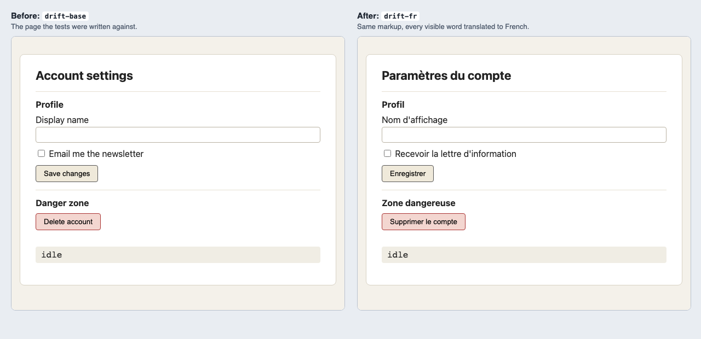

# Drift testbed

Small static sites with drifted variants, a Python and a TypeScript suite for each, and the tools that run them through the heal
service. Everything is local: plain HTML/CSS/JS, no CDNs, no web fonts, no network, served on 127.0.0.1 only.

| Spec | Base site | Variants | What it is for |
| --- | --- | --- | --- |
| `drift` | `site/drift-base/` | `drift-renid`, `drift-fr`, `drift-dup`, `drift-noid`, `drift-gone` | one page, one situation per variant, small enough to read; the acceptance runner's core |
| `orders` | `site/orders-base/` | `v7`, `v8`, `v9` | a hard-locator spec: deep chains, hooks, aria, generated classes, xpath, frames, shadow DOM |
| `real` | `site/real-base/` | `v10`, `v11`, `v12` | 82 locators copied from public suites (see below) |
| `signup` | `site/base/` | `v1` (renames), `v6` (French) | a four-step flow; `v1` is pure locator drift, `v6` the same site in French |

The flow-repair variants of the original signup site (missing and moved fields, widget swaps) are not here: this service heals locators and
ends `needs_human` on a flow change.

## Files

- `site/<variant>/` full standalone copies of a base with strict patches; each has a `CHANGES.md` listing every change and, for each test line
  it affects, what a correct heal does.
- `tests/python/` pytest suites (`test_drift.py`, `test_orders.py`, `test_real.py`, `test_signup.py`) and `conftest.py` (a plain-Playwright `page`
  fixture, the `by_language` helper and the failure and fingerprint hooks the acceptance run uses). `tests/ts/` the same suites for
  `@playwright/test` (`drift.spec.ts`, `orders.spec.ts`, `real.spec.ts`, `signup.spec.ts`).
- `golden-drift.json`, `golden-orders.json`, `golden-real.json` the correct heal of every broken locator (null = the element is gone), with, for
  the drift spec, the outcome the service is expected to give. `expected*.json` what the suites do against each variant with no healing.
- `build_drift.py`, `build_variants.py`, `build_real.py` regenerate the variants, `CHANGES.md` and golden files from the bases.
  `run_expected.py` regenerates `expected*.json` (it runs both languages; the TypeScript side needs `npm install` in `tests/ts`).
  `verify_golden.py` applies every golden heal and runs the suites with no model (all must pass; `--each` leaves one out and checks it fails).
- `serve.py` the static server. `run_acceptance.py` the service acceptance run. `acceptance-gaps.json` the known misses (below).
  `bench.py` runs the acceptance run once per model and compares them; `bench_report.py` builds that comparison (below).

## The drift spec

`site/drift-base/` is an "Account settings" page: a display-name input (id, name, test id), a newsletter checkbox that has no attribute at all,
a Save button (id, test id) and a Delete button (id, test id). The suites have three tests (`profile settings`, `save by test id`,
`delete account`) whose locators are an id, a role+name, a test id and a role+name. The summary line holds machine values only.

| Variant | Change | Expected outcome |
| --- | --- | --- |
| `drift-renid` | the input's id is renamed; its test id stays | `healed` to the test id, from the passing run's fingerprint (step 2, no model call), tier up |
| `drift-fr` | `<html lang="fr">`, all copy translated, same markup | checkbox: `healed` with a language branch (en + fr); Save and Delete: `healed` to their test ids with no branch (copy is never translated) |
| `drift-dup` | a second "Save changes" button is added | `healed` to the original button (fingerprint), not the new one |
| `drift-noid` | the Save button's test id is removed, its id stays | `healed` to the id: one tier down, `below_floor` true |
| `drift-gone` | the Delete button is removed | `needs_human`, never a nearby button |

The change is visible in the browser. This is `drift-base` next to `drift-fr`: the markup, ids and test ids are the same, and every word
on the page is French, so the tests' `get_by_role(..., name="Save changes")` locators stop matching.



## The diagnose spec

`POST /v1/diagnose` is for failures where every locator still matches. `build_diagnose.py` makes five more copies of `site/drift-base/`, each
broken in a way no locator mends (`diag-reworded`, `diag-noop`, `diag-slow`, `diag-strict`, `diag-confirm`; see their `CHANGES.md`), and writes
`golden-diagnose.json`: nine cases, each a variant, a test of `tests/python/test_diagnose.py`, the earlier heals applied to it
(`prior_heals`, on the existing `drift-dup` and `drift-gone` too) and the key (cause, the heal to revert, the edit). `diagnose-gaps.json` lists what is
not built.

```
uv run python testbed/run_diagnose.py --model fake     # offline: the oracle and four adversarial scripted models
HEAL_TEXT_BASE_URL=... HEAL_TEXT_MODEL=... uv run python testbed/run_diagnose.py --model env   # a real model; accuracy and confusion matrix, information only
```

It runs each case's test once, builds the request from the failing page, and sends it to an in-process service with diagnose on. Under the oracle every
answer must equal the key; under `real-id` (always `earlier_heal_wrong_element`, naming a sent heal), `made-up-id`, `empty-priors` (no heal sent) and
`patch-always` (an edit whatever the cause) `wrong cause kept` and `edit on a non-edit cause` must be 0. The exit status is 1 otherwise.

## Serve and run the suites yourself

```
uv run python testbed/serve.py            # http://127.0.0.1:8765/  (--port N)
cd testbed/tests/python
QA_BASE_URL=http://127.0.0.1:8765/drift-fr/ uv run python -m pytest -q test_drift.py     # QA_ACTION_TIMEOUT_MS=1500 for quick failures
cd ../ts && npm install && npx playwright install chromium
QA_BASE_URL=http://127.0.0.1:8765/drift-fr/ npx playwright test drift.spec.ts
```

The Python suites need only Playwright and a chromium build (`uv sync --extra browser && uv run playwright install chromium`).
`goto` lines build the route by concatenation of a literal, `page.goto(BASE + "index.html")`: an f-string left the page route unresolvable for
tools reading the source.

## The acceptance run

```
uv run python testbed/run_acceptance.py --model fake                    # drift + orders, offline
uv run python testbed/run_acceptance.py --model fake --spec drift --variants drift-fr
uv run python testbed/run_acceptance.py --model fake --spec real        # ~5 minutes
uv run python testbed/run_acceptance.py --model fake --fingerprints off # every heal starts at the text pick
HEAL_TEXT_BASE_URL=... HEAL_TEXT_MODEL=... uv run python testbed/run_acceptance.py --model env   # the service's own model settings
uv run python testbed/run_acceptance.py --service-url http://localhost:8765                         # a running service
```

It serves the sites, records a fingerprint for every statement on the base site (a clean green run), then for each variant and each test runs the
suite in a temp copy. At each failure it builds a real `POST /v1/heal` request (the probe's listing and the aria snapshot of the page **as it was at
the failure**, the test file with its hash, the stack frames of the test file, the recorded fingerprint) and walks the `try` -> `result`
conversation: apply the patch to the temp copy, re-run the exact test, check the patched statement's match count and which element it hit, report.
A candidate that does not hold is reverted. The repository's test files are never edited. After a `needs_human` the run applies the golden
replacement as a person would, so the rest of the test still exercises its other drifts.

A re-run is judged `passed` when the test passes, or when it now fails on a **later statement** because a locator timed out or matched twice (the
healed line got through), or on any line past the healed statement's own `expect(` check (the statement and its check held; what failed is a later
statement's own drift, such as its locator now hitting another element). Any other failure, or the same statement again, is `failed`: an assertion
failing on the heal's own check rejects it, which is how a locator that hit the wrong element is caught. A stricter client may demand a full green
test. (The TypeScript run's judge, in `ts_step.mjs`, still has the earlier rule: locator problems on a later statement only.)

`--model fake` scripts the model: the pick is the element the golden file names (resolved in the live failing page), the usage is a fixed
estimate of the prompt size, no endpoint is called. `--model env` uses the service's own `HEAL_TEXT_*` settings; nothing is set or guessed here.

`--vision off|auto|on` is the client's `HEAL_VISION`. `off` (the default) changes nothing: no screenshot is taken, none is sent, and the
numbers are those of a run without the option. `auto` and `on` make the failing run dump one viewport screenshot (and the viewport and scroll
it was taken in) and put them in the request; the service may use them (see `docs/ARCHITECTURE.md`, step 4). With `--model fake` the vision
model is scripted as well, and on purpose it is not an oracle everywhere: when the golden element exists it answers with that element's
mark, and when the element is gone (or not on the list) it answers with the first drawn mark, as a model that must always name something
would. The gates have to refuse that pick, so `wrong kept` has to stay 0 in every vision mode. What a fake cannot show is whether a real vision
model *finds* more elements than text does: that needs `--model env` with `HEAL_VISION_*` set (and `HEAL_VISION_IMAGES_ALLOWED=true`). The
report adds images sent, how often vision ran and how often it changed the text pick.

Output goes to `testbed/.runs/acceptance/` (`--out`): `acceptance.json` (every step: the request outcome, the settled-at step, calls, tokens, tries,
candidates) and `acceptance.md` (the per-variant table and the steps). The exit status is 1 when a step misses its expectation, a healed step is not
on the golden element, or a base run is red.

For debugging, `HEAL_TESTBED_DUMP_REQUESTS=<dir>` saves every heal request as sent (`<spec>-<run>-<test>-<line>.json`). A row with no golden
element says why in `target_note` (no golden step for the line, the golden expression did not resolve, or the element is not in the probe's
listing: the bench pages copy real apps' markup but not their CSS, so a div that is clickable only by its pointer cursor is not listed; a
plain element that holds copy is listed as `copy_only`, and a golden frame element is told from its page-level twins by the frame it sits in). A
single hit the listing cannot match records the differing facts in `hit_notes`.

### Known gaps

`acceptance-gaps.json` records the steps of the `orders` and `real` specs where the service, in its current phase 1, does not reach the golden heal,
with the outcome and reason it gives instead (a `needs_human` with `no_stable_locator`, `no_pick` or `no_candidate_left`). A step in that file counts as
met while the service still gives that answer; if the service starts healing it, the row is flagged `gap_closed` and the entry should be removed.
The gaps apply to the fake model with default settings only. `--write-gaps` rewrites the file from the current run: review the diff.

## Comparing models: the bench

`bench.py` runs the acceptance run once per model (an arm) and writes one comparison: the scripted `fake` arm is always the first column
(the ceiling: what the pipeline gives when the model's pick is right), then each model. Use it when a model did poorly and you want to see how
a stronger one does on the same broken suites. Everything is measured against the golden files; no request is captured or replayed and nothing
is run in shadow.

```
export CHEAP_KEY=... STRONG_KEY=...          # the keys stay in the environment; an arm names the variable, never the key
uv run python testbed/bench.py \
  --arm name=cheap,base_url=http://localhost:8000/v1,model=small-7b,api_key_env=CHEAP_KEY \
  --arm name=strong,base_url=http://localhost:8001/v1,model=big-70b,api_key_env=STRONG_KEY,price_input=0.6,price_output=2.4 \
  --spec drift orders --repeat 3 --fingerprints off
```

`uv sync --all-extras && uv run playwright install chromium` first (the suites need Playwright). Reports go to `testbed/.runs/bench/`
(`--out`): `bench.md`, `bench.json`, and under `<arm>/run<N>/` each run's `acceptance.json`, `acceptance.md` and `run.log`.

**Arms.** A `--arm` flag is `key=value` pairs separated by commas: `name`, `base_url`, `model`, `provider` (`openai`, the default, or
`anthropic`), `api_key_env` (the NAME of the variable holding the key, in capitals), `price_input` and `price_output` (per million tokens,
for the cost row). A value that needs a comma (an `extra_body`) goes in a JSON object instead: `--arm '{"name": "x", "base_url": "...",
"model": "...", "extra_body": {"temperature": 0}}'` (the report names an `extra_body`'s keys and never prints its values; a value that is a credential belongs in `--arms-file`, since a
flag shows in the process list). The bench prints which variable each arm sends to which host before it starts. The
service's own egress rule applies to every `base_url`: https anywhere, plain http only to a loopback or private host. Many arms are easier in a file: `--arms-file arms.json` (`{"arms": [ ... ]}`) or
`arms.toml` (`[[arms]]` tables) with the same fields. The name `fake` is the ceiling's and is added for you.

**Fairness.** Every arm runs the same specs and client and the same shared settings, given once and printed at the top of the report:
`--max-tokens`, `--candidate-cap`, `--max-calls`, `--timeout-s` (the model request), `--action-timeout-ms` (the suites), `--thinking`,
`--fingerprints`. Unset, they are the service's own defaults, and the report shows the values in force. Each arm's run starts from your
environment with every `HEAL_*` variable removed (except `HEAL_MODEL_PRICES`, shared by all arms, and `HEAL_TS_CLIENT_DIR`), so nothing set in your
shell can favour one arm. Use `--fingerprints off` to make every heal start at the text pick; with the default `on`, most `drift` steps
settle at step 2 without a model call and the models differ on fewer steps.

**Repeats and order.** `--repeat N` runs each model arm N times, because a real model is not repeatable; the report shows min, max and mean.
The scripted arms are deterministic and run once. Arms run one after the other; `--parallel-arms` runs them at the same time (the repeats of
one arm never overlap), which is faster when the arms are different servers and wrong when they share one GPU, since latency would then
include the wait for the other arm.

**What the report holds.** A header line (date, voyageur version, git commit, specs, client, repeats); the shared settings and any setting an
arm sets for itself (only a scripted arm may: `kind=fake,candidate_cap=8`, which is how the bench is proved without a model); a table with
one column per arm: healed, needs_human and its reasons, wrong heals kept, wrong element caught, steps run / golden, steps matching the golden
file, model calls, tokens, cost (n/a without a price), heal latency and model-call latency p50 and p95; a fit line per arm (its wrong heals
kept, and its healed count as a share of the ceiling's); and the steps where the arms differ, each arm's pick (the locator it wrote, or its
needs_human reason) marked `ok`, `MISS` (no heal where the golden file has an element) or `WRONG` (a heal on another element, or where the
element is gone). `docs/RESULTS.md` says how to read each number.

The exit status is 2 for a malformed arm or an unset key variable (nothing ran), 1 when an arm produced no result or the scripted ceiling kept
a wrong heal, 0 otherwise: a real model's misses and wrong heals are findings in the report, not failures of the bench. The bench is not a
`voyageur` subcommand on purpose: it needs this directory (the sites, suites and golden files, and a Playwright browser), which an installed
package does not have, and the package may not run programs.

## The hard-locator spec (orders, v7-v9)

The signup tests use the locators a recorder writes (label, role, placeholder, test id). Real suites also carry deep
`div > div:nth-child()` chains, data-qa / data-cy hooks, aria attributes, generated class names, xpath, frames and shadow
roots. This spec tests the healer (and the locator policy: test id > hand-written id > name > css on a non-copy attribute
> role+name > label > text > structural chain) on those.

- `site/orders-base/`: an orders dashboard. A data table (`data-testid="orders-table"`, 6 rows with `data-qa="order-row-N"`,
  status badges, a per-row actions button that opens a nested menu rendered into a portal), a filter toolbar, an activity
  grid of divs, a side panel with tabs (`role=tab` / `tabpanel`, ids and `aria-labelledby`), a notes textarea, a cancel
  button with a generated class (`sc-fzXfKy jQdBvX`) and nothing else stable, a modal dialog, an iframe holding a card
  form (`payment.html`) and an open shadow-DOM component (`<order-flag>`). Wrappers are several divs deep.
- `tests/python/test_orders.py` / `tests/ts/orders.spec.ts`: three tests (`orders grid and toolbar`, `side panel and
  dialog`, `payment frame and shadow`), one locator style per line. The assertions read only a
  `data-testid="summary"` line made of keys and machine values (`selected: 1042`, `status.1043: paid`, `visible:
  1042,1043,1044`, `card_last4: 4242`), never copy.
- `site/v7` restructure, `v8` attribute churn, `v9` mixed. Each has a `CHANGES.md` listing every changed locator and its
  correct heal. `golden-orders.json` holds those heals in machine form and `verify_golden.py` applies them to the suites
  and runs them (no model): all heals applied must pass, and with `--each` leaving any one heal out must fail at exactly
  that line.

| variant | what changes | lines that break (python) |
|---|---|---|
| orders-base | reference | none |
| v7 | banner + wrapper div, side column first in the DOM, Total before Status, a divider row, chips reordered, notes textarea wrapped, every class hashed | L13 status button, L15 xpath, L17 grid, L25 chip, L40 textarea, L43/49 cancel button, L67 shadow toggle |
| v8 | `data-qa` -> `data-testid` (rows, status), `data-cy` -> `data-testid` (export), aria-labels reworded, hand-written ids -> `:rN:` | L19 menu button, L28 status, L30 export, L36 tab, L37 panel li, L40 textarea, L47 close, L59/60/61 iframe |
| v9 | chip wrapper, regenerated class, status hook renamed, tab id generated, close label reworded, a customer renamed, Export CSV removed (NONE), ZIP moved into the iframe, notes textarea moved into a shadow root | L23 row checkbox, L25 chip, L28 status, L30 export (NONE), L36 tab, L37 panel li, L40 textarea, L43/49 cancel, L47 close, L58 zip |

Without healing, the first failure per test (action timeout, 5 s) is in `expected-orders.json`. `run_acceptance.py --spec orders` runs the service on it.

## The real-locator spec (real, v10-v12)

The orders spec above uses locator styles seen in real suites. This one reproduces the locators themselves: 82 locators copied
from public Playwright (python and ts), Selenium and Cypress suites (a catalog of about 110 was collected first), each with the
smallest markup that makes it resolve and, where the locator comes from a component library, that library's DOM. The comment
above every test line names its category and kind of source (no repository names).

- `real_catalog.py` the entries: locator, action, markup, and what each variant changes with the correct heal. `build_real.py`
  generates everything from it: `site/real-base/` (14 pages, one test each), `site/v10..v12/`, `tests/python/test_real.py`,
  `tests/ts/real.spec.ts` (same steps), `golden-real.json` and each variant's `CHANGES.md`. Run it after editing the catalog.
- Categories (steps): structural chains 8 (a 24-hop absolute chain, css-module and `useId` ids, absolute and mount-id xpath),
  nth / position 8 (`nth-child`, `:nth-match`, `>> nth=-1`, `~`), xpath axes 10 (`ancestor::`, `following-sibling::`,
  `count(preceding-sibling)`, `not()`), data attributes 5 (`data-test`, `data-qa`, `data-id`, a union selector), aria 7,
  text 6 (`:text-is`, `:has-text`, regex), generated classes and ids 7 (emotion, styled-components, tailwind, `:r1:`),
  frames 5 (random-suffix names, nested, moved out), shadow DOM 4 (host + inner input, vendor internals), scoped chains 9
  (`filter(has=)`, regex name cell, parent hop, `:right-of`), component libraries 11 (react-select, MUI menu and select popup,
  ag-grid with pinned and sorted rows, AntD, Select2, react-datepicker, headless-ui portal).
- The assertions read only `hit.<key>: <value>` in the page's `data-testid="summary"` line. A marker `data-hit` in the source
  html is read by `real_assets/hit.js` and removed at boot, so the live DOM has no test hook a healer could use; frames post
  their hits to the parent and shadow-root controls are registered by `components.js`.
- v10 restructure (24 changes): wrappers added or removed, siblings added or reordered, columns and panes reordered, pinned
  grid column. Several resolve to the WRONG element and fail the assertion, not a timeout. v11 attribute churn (39): hash classes
  and generated ids regenerate, hooks renamed, copy and labels change, library renames. Two changes must stay green (the locator
  matches the stable part). v12 mixed (15 + 1): elements moved into an iframe and a shadow root, one moved out of an iframe, a
  re-sorted grid, a data re-seed, and one element removed (`a51`, expect NONE; a decoy button is renamed so nothing matches).
- The frame steps of this spec (`f71`-`f75`) and the payment frame of `orders` v8 exercise frame hop healing (`frame_heal.py`): a renamed
  iframe is found by the element in it that identity proof accepts (`f73`: the id `cn` is unchanged; `f74`: the nested frame holds the
  one `确认` button) and written by its title, keeping the parent hops and the step's own locator; an element that left its frame
  (`f75`, a bare class `.wp-block-post-title`) stays `needs_human`: a bare class cannot be shown unique from the listing, so the
  hop is not dropped on it (the same move on an id, hook or `button.primary` selector heals).
- `python3 verify_golden.py --spec real [--each]` applies every heal of `CHANGES.md` and runs both suites (no model); with `--each`
  leaving any single heal out must fail at that line or at the assertion right after it. `run_expected.py --spec real` writes
  `expected-real.json`. `run_acceptance.py --spec real` runs the service on it.


## Results

The scripted-model and real-model runs, per variant, are in [docs/RESULTS.md](../docs/RESULTS.md), with the commands to repeat them.
